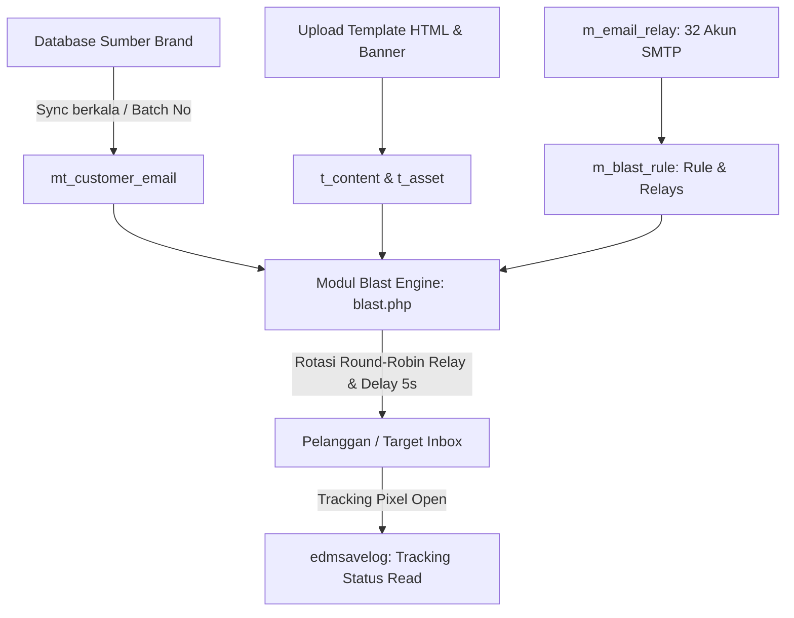
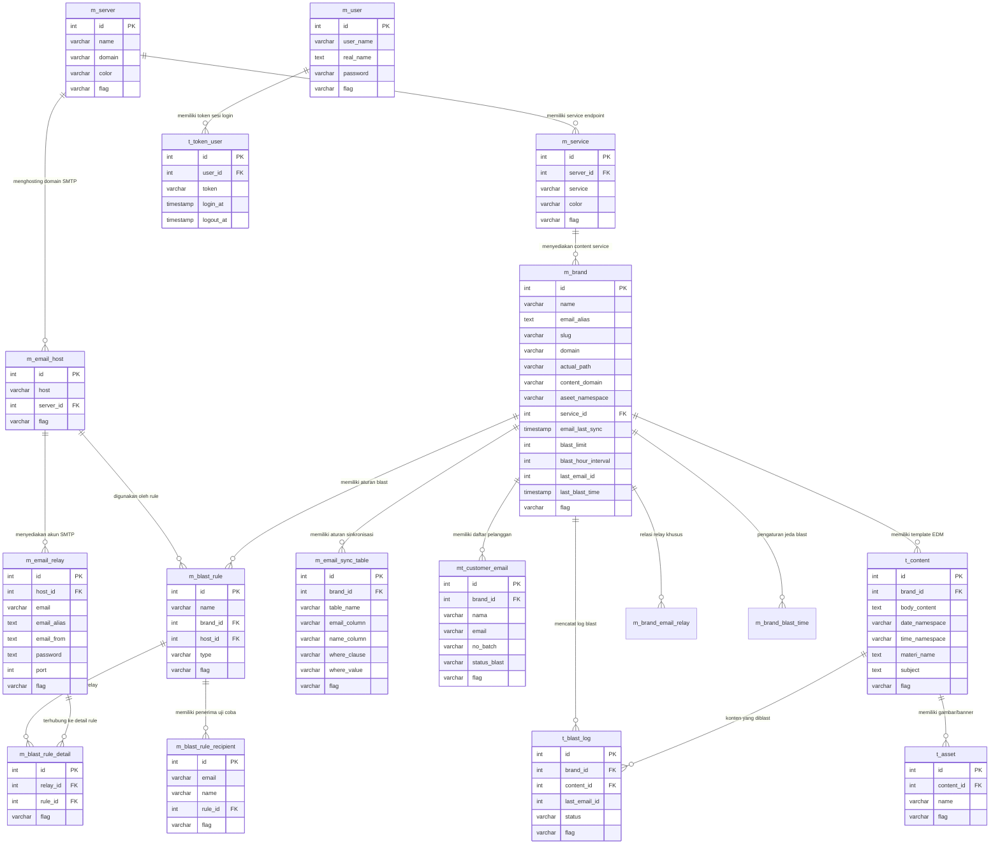

# DOKUMENTASI SISTEM COSMOSENDER
**Aplikasi Blasting Email Promosi & Manajemen Konten EDM (Electronic Direct Mail)**  
PT Indraco / Supresso Group  
Lokasi Dokumen: `C:\laragon\www\#indraco\cosmosender\documentation\documentation.md`  
Tanggal Analisa: November 2026  

---

## DAFTAR ISI
1. [Ringkasan Proyek & Arsitektur Sistem](#1-ringkasan-proyek--arsitektur-sistem)
2. [Alur Kerja & Fitur Utama (Workflow)](#2-alur-kerja--fitur-utama-workflow)
3. [Analisa Database (`supresso_mailblast.sql`)](#3-analisa-database-supresso_mailblast-sql)
4. [Diagram ERD (Entity Relationship Diagram)](#4-diagram-erd-entity-relationship-diagram)
5. [Daftar Detail Tabel Database](#5-daftar-detail-tabel-database)
6. [Catatan Server Email & Kredensial Lengkap](#6-catatan-server-email--kredensial-lengkap)
   - [6.1 Kredensial Database](#61-kredensial-database)
   - [6.2 Kredensial Login Aplikasi (Admin)](#62-kredensial-login-aplikasi-admin)
   - [6.3 Daftar Server & Host SMTP](#63-daftar-server--host-smtp)
   - [6.4 Daftar Lengkap Kredensial Akun Email Relay (SMTP)](#64-daftar-lengkap-kredensial-akun-email-relay-smtp)
7. [Panduan Instalasi & Pemeliharaan](#7-panduan-instalasi--pemeliharaan)

---

## 1. Ringkasan Proyek & Arsitektur Sistem

### 1.1 Deskripsi Aplikasi
**Cosmosender** adalah aplikasi web internal berbasis PHP native yang dirancang khusus untuk mengelola materi promosi email (EDM / *Electronic Direct Mail*) dan melakukan pengiriman massal (*email blasting*) ke basis pelanggan berbagai lini merek (*brand*) di bawah naungan PT Indraco, antara lain:
- **Supresso Singapore (`Supresso SG`)**
- **Supresso Indonesia (`Supresso ID`)**
- **Indraco Store (`Indraco Store`)**
- **Pandan Garden (`Pandan Garden`)**

Aplikasi ini mengatasi kendala pembatasan limit pengiriman email (*rate limiting*) dan pencegahan deteksi spam (*anti-spam / ISP throttling*) dengan menerapkan teknik **Round-Robin Multi-Relay SMTP**, jeda waktu otomatis (*sleep interval*), pembagian kuota per jam, serta sinkronisasi berkala data penerima dari database toko online.

### 1.2 Tech Stack
- **Backend**: PHP Native (mendukung PHP 7.4 - 8.x)
- **Database**: MySQL / MariaDB (Database: `supresso_mailblast`, Charset: `utf8mb4_general_ci`)
- **Database Abstraction**: `BaseModel` & `TransModel` (Custom Mini-ORM mysqli wrapper)
- **Email Engine**: PHPMailer v6.x (metode SMTP dengan enkripsi SSL pada Port 465)
- **Frontend**: HTML5, Bootstrap 5, Bootstrap Icons, jQuery, AJAX
- **Enkripsi Kredensial**: OpenSSL AES-128-CTR (Kunci: `indraco`, IV: `0909090909090909`)

### 1.3 Struktur Direktori
```text
cosmosender/
├── .well-known/            # Verifikasi web / SSL
├── asset/                  # Asset CSS, JS (jQuery, Bootstrap), Images
├── basemodel/              # Layer database (Config.php, BaseModel.php, TransModel.php)
├── documentation/          # Berkas dokumentasi teknis (documentation.md)
├── src/                    # Backend API and Service Modules
│   ├── common/             # Konfigurasi project & database (common-config.php, local-config.php)
│   ├── PHPMailer/          # Library pengiriman email PHPMailer & SMTP
│   ├── api.php             # Core API router
│   ├── Auth.php            # Autentikasi & enkripsi AES-128-CTR
│   ├── blast.php           # Runner eksekusi email blast langsung
│   ├── blast-api.php       # Controller API blasting & test blast
│   ├── blast-rule-api.php  # Controller konfigurasi rule & relay assignment
│   ├── brand-api.php       # Controller CRUD brand
│   ├── content-api.php     # Controller materi konten HTML & upload asset
│   ├── email-relay-api.php # Controller manajemen akun SMTP relay
│   ├── email-sync-api.php  # Controller sinkronisasi penerima email dari database brand
│   ├── host-api.php        # Controller host server email
│   ├── server-api.php      # Controller data fisik server
│   ├── service-api.php     # Controller content service URL
│   └── response.php        # Standarisasi output JSON response
├── view/                   # Antarmuka Pengguna (UI)
│   ├── blast/              # Halaman eksekusi blasting & pemilihan rule
│   ├── blastrule/          # Halaman pengaturan aturan blasting (Test & Blast)
│   ├── brand/              # Halaman konfigurasi brand & limitasi
│   ├── configemailsync/    # Konfigurasi pemetaan kolom tabel sumber email
│   ├── content/            # Pembuatan & pratinjau template HTML email
│   ├── emailrelay/         # Manajemen kredensial SMTP relay
│   ├── host/               # Pengaturan domain host SMTP
│   ├── server/             # Pengaturan server & domain konten
│   ├── service/            # Pengaturan service path
│   └── useremail/          # Antarmuka monitoring sinkronisasi email pelanggan
├── header.php, navbar.php  # Template layout umum
├── footer.php, denied.php  # Template error & penutup
├── index.php               # Dashboard utama aplikasi
├── login.php, logout.php   # Manajemen sesi user
├── supresso_mailblast.sql  # Berkas dump schema & data database
└── README.md               # Catatan versi rilis aplikasi
```

---

## 2. Alur Kerja & Fitur Utama (Workflow)



1. **Sinkronisasi Penerima (`Email Sync`)**:
   - Konfigurasi tabel sumber diatur pada `m_email_sync_table` (misal tabel `mailblastpandan`, `masterpelanggan`, `mailblastid`, `mailblast`).
   - Sistem membaca data email aktif kemudian menyimpannya ke `mt_customer_email` dengan nomor batch unik (`no_batch = brand_id + ymdhis`).
   - Email yang tidak lagi ditemukan di database sumber akan dinonaktifkan (`flag = 'N'`).
2. **Manajemen Konten EDM (`Content Management`)**:
   - Materi email disusun dalam format HTML lengkap dengan banner, styling responsif, tautan produk, dan tracking pixel.
   - Tag dinamis `{email}` disediakan dalam konten untuk disubstitusikan secara otomatis dengan alamat email masing-masing penerima saat dikirim.
   - Asset gambar diunggah ke namespace direktori brand di content server (`mbcontentservices/`).
3. **Penerapan Aturan Blasting (`Blast Rules`)**:
   - **Tipe `test`**: Mengirimkan sampel email ke daftar tim internal/QA (`m_blast_rule_recipient`) untuk validasi sebelum rilis publik.
   - **Tipe `blast`**: Mengirimkan email promosi massal ke basis pelanggan dari tabel `mt_customer_email`.
4. **Eksekusi Blasting & Rotasi Relay (Anti-Banned / Anti-Spam)**:
   - Sistem mengambil batch penerima sesuai `blast_limit` (misal 25 - 300 email per batch) mulai dari `last_email_id`.
   - Menggunakan algoritma **Round-Robin** bergantian memakai puluhan akun SMTP (`m_email_relay`) dari host terkait.
   - Terdapat jeda `sleep(5)` setiap satu putaran penuh relay selesai dieksekusi agar tidak dianggap aktivitas *flooding* oleh server email target.
   - `last_email_id` dan `last_blast_time` pada tabel `m_brand` langsung diperbarui secara *real-time*. Jika batas akhir ID tercapai, sistem melakukan *wrap-around* ke data awal.
5. **Pelacakan Email Terbuka (Tracking Pixel)**:
   - Konten email menyematkan tag pelacak tak terlihat:
     ```html
     
     ```
   - Berfungsi mencatat performa rasio buka email (*open rate*).

---

## 3. Analisa Database (`supresso_mailblast.sql`)

- **Nama Database**: `supresso_mailblast`
- **Total Tabel**: 22 Tabel
- **Mesin Penyimpanan**: InnoDB
- **Karakter Set & Collation**: `utf8mb4` / `utf8mb4_general_ci`
- **Pengelompokan Tabel**:
  1. **Master Core**: `m_server`, `m_service`, `m_brand`, `m_user`.
  2. **SMTP & Relay**: `m_email_host`, `m_email_relay`, `m_brand_email_relay`.
  3. **Blast Configuration**: `m_blast_rule`, `m_blast_rule_detail`, `m_blast_rule_recipient`, `m_brand_blast_time`.
  4. **Penerima & Sinkronisasi**: `mt_customer_email`, `m_email_sync_table`, `m_customer_table`, `t_customer_email`.
  5. **Konten & Asset**: `t_content`, `t_asset`.
  6. **Log & Sesi**: `t_blast_log`, `t_service_token`, `t_token_user`.
  7. **Tabel Backup / Arsip**: `mailblastindrstore`, `mt_customer_email_20112023`.

---

## 4. Diagram ERD (Entity Relationship Diagram)

Diagram relasi entitas berikut memetakan keterkaitan logis antar tabel master dan transaksi dalam database `supresso_mailblast`:



---

## 5. Daftar Detail Tabel Database

### A. Tabel Master

#### 1. `m_server`
Menyimpan identitas fisik server yang digunakan sebagai penampung konten dan service.
- `id` (int UNSIGNED, PK, AI): ID Server.
- `name` (varchar 100): Nama server (contoh: `Solindo`, `Niaga`).
- `domain` (varchar 100): URL root / domain server (`cosmosender.supresso.co.id/`, `indraco.net/`).
- `color` (varchar 50): Kode warna hex untuk UI badge.
- `flag` (varchar 1): Status aktif (`Y`/`N`).

#### 2. `m_service`
Menyimpan path service konten pada server tertentu.
- `id` (int UNSIGNED, PK, AI): ID Service.
- `server_id` (int UNSIGNED, FK ke `m_server.id`): Relasi ke server fisik.
- `service` (varchar 100): Direktori service endpoint (`mbcontentservices/`).
- `color` (varchar 50): Warna badge UI.
- `flag` (varchar 1): Status aktif (`Y`/`N`).

#### 3. `m_brand`
Tabel konfigurasi utama untuk setiap merek produk yang dikelola.
- `id` (int UNSIGNED, PK, AI): ID Brand.
- `name` (varchar 100): Nama brand (`Pandan Garden`, `Indraco Store`, `Supresso ID`, `Supresso SG`).
- `email_alias` (text): Display name pengirim email (contoh: `Supresso Coffee`, `INDRACO Store`).
- `slug` (varchar 100): Identitas URL unik brand.
- `actual_path` (varchar 100): Lokasi direktori fisik server cPanel/hosting.
- `content_domain` (varchar 255): Domain publik untuk akses materi newsletter & gambar.
- `aseet_namespace` (varchar 100): Nama folder asset (`newsletterv2`).
- `service_id` (int UNSIGNED, FK ke `m_service.id`): ID service terkait.
- `email_last_sync` (timestamp): Waktu sinkronisasi terakhir kontak pelanggan.
- `blast_limit` (int): Kuota maksimal pengiriman email per batch (contoh: 25 untuk Supresso SG, 300 untuk Supresso ID).
- `blast_hour_interval` (int): Jeda waktu minimum dalam jam antar-blasting.
- `last_email_id` (int UNSIGNED): Pointer ID terakhir dari `mt_customer_email` yang telah dikirim.
- `last_blast_time` (timestamp): Waktu eksekusi blasting terakhir.
- `flag` (varchar 1): Status aktif brand (`Y`/`N`).

#### 4. `m_email_host`
Menyimpan daftar domain/hostname SMTP mail server.
- `id` (int UNSIGNED, PK, AI): ID Host SMTP.
- `host` (varchar 100): Hostname server email (`mail.indracostore.com`, `mail.supresso.com`, `pandangarden.com`).
- `server_id` (int UNSIGNED, FK ke `m_server.id`): Relasi ke server penampung.
- `flag` (varchar 1): Status aktif (`Y`/`N`).

#### 5. `m_email_relay`
Tabel vital yang menyimpan seluruh akun SMTP pengirim (*relay pool*) beserta kredensial otentikasinya.
- `id` (int UNSIGNED, PK, AI): ID Relay.
- `host_id` (int UNSIGNED, FK ke `m_email_host.id`): Relasi ke host SMTP.
- `email` (varchar 100): Alamat email akun SMTP (username login).
- `email_alias` (text): Nama pengirim default.
- `email_from` (text): Header `From:` pada email yang dikirim (misal `edm.sg@supresso.com`, `no-reply@indracostore.com`).
- `password` (text): Password akun email SMTP.
- `port` (int): Port SMTP (default: 465 untuk SSL).
- `flag` (varchar 1): Status aktif akun (`Y`/`N`).

#### 6. `m_blast_rule`
Menentukan aturan blasting (pengelompokan relay dan jenis blast).
- `id` (int UNSIGNED, PK, AI): ID Rule.
- `name` (varchar 255): Nama aturan (`Blast`, `Send Test 1`, `Self`).
- `brand_id` (int UNSIGNED, FK ke `m_brand.id`): Relasi ke brand pemilik.
- `host_id` (int UNSIGNED, FK ke `m_email_host.id`): Host SMTP yang digunakan.
- `type` (varchar 50): Jenis rule (`test` untuk internal uji coba, `blast` untuk kirim publik).
- `flag` (varchar 1): Status aktif (`Y`/`N`).

#### 7. `m_blast_rule_detail`
Tabel perantara (*many-to-many*) yang menentukan akun relay (`m_email_relay`) mana saja yang aktif dalam suatu rule (`m_blast_rule`).
- `id` (int UNSIGNED, PK, AI): ID Relasi.
- `relay_id` (int UNSIGNED, FK ke `m_email_relay.id`): Akun SMTP relay.
- `rule_id` (int UNSIGNED, FK ke `m_blast_rule.id`): Aturan blast terkait.
- `flag` (varchar 1): Status aktif relay dalam rule tersebut (`Y`/`N`).

#### 8. `m_blast_rule_recipient`
Menyimpan daftar alamat email dan nama penerima khusus untuk pengujian internal (*Test Rule*).
- `id` (int UNSIGNED, PK, AI): ID Penerima Tes.
- `email` (varchar 255): Email tester (misal: tim dev, marcom, QA).
- `name` (varchar 255): Nama tester.
- `rule_id` (int UNSIGNED, FK ke `m_blast_rule.id`): Rule pengujian terkait.
- `flag` (varchar 1): Status aktif (`Y`/`N`).

#### 9. `m_email_sync_table`
Menyimpan aturan pemetaan nama tabel dan kolom sumber untuk proses sinkronisasi email pelanggan.
- `id` (int UNSIGNED, PK, AI): ID Mapping.
- `brand_id` (int UNSIGNED, FK ke `m_brand.id`): Brand terkait.
- `table_name` (varchar 100): Nama tabel sumber pelanggan di database eksternal/asal.
- `email_column` (varchar 100): Kolom yang berisi alamat email.
- `name_column` (varchar 100): Kolom yang berisi nama pelanggan.
- `where_clause` (varchar 100): Kolom filter (misal: `subrek`, `setujunews`).
- `where_value` (varchar 100): Nilai filter (misal: `subscribed`, `setuju`).
- `flag` (varchar 1): Status aktif (`Y`/`N`).

#### 10. `m_user`
Menyimpan data pengguna backoffice aplikasi Cosmosender.
- `id` (int UNSIGNED, PK, AI): ID Pengguna.
- `user_name` (varchar 100): Username (`admin`).
- `real_name` (text): Nama lengkap pengguna.
- `password` (varchar 255): Password terenkripsi AES-128-CTR (`Y2p5` = `123`).
- `flag` (varchar 1): Status aktif (`Y`/`N`).

---

### B. Tabel Transaksional

#### 11. `mt_customer_email`
Tabel utama penyimpan seluruh basis kontak email pelanggan hasil sinkronisasi yang siap menerima blasting promosi.
- `id` (int UNSIGNED, PK, AI): ID Kontak.
- `brand_id` (int UNSIGNED, FK ke `m_brand.id`): Brand pemilik kontak.
- `nama` (varchar 255): Nama pelanggan.
- `email` (varchar 255): Alamat email pelanggan.
- `no_batch` (varchar 100): Kode unik batch sinkronisasi.
- `status_blast` (varchar 255): Status kesiapan email (`ready`, `sent`, dsb).
- `flag` (varchar 1): Status langganan aktif (`Y` aktif, `N` non-aktif/unsubscribe).

#### 12. `t_content`
Menyimpan materi kampanye newsletter promosi (EDM).
- `id` (int UNSIGNED, PK, AI): ID Konten.
- `brand_id` (int UNSIGNED, FK ke `m_brand.id`): Brand terkait.
- `materi_name` (text): Judul internal materi promosi (contoh: `11 sebelas`, `Diwali`).
- `subject` (text): Subject email yang ditampilkan di inbox target (contoh: `🛍️ 11.11 SPECIAL DEALS, BETTER COFFEE!`).
- `body_content` (text): Template utuh kode HTML email.
- `date_namespace` (varchar 8): Kode tanggal versi konten (contoh: `261111`).
- `time_namespace` (varchar 8): Kode waktu konten (contoh: `1100`).
- `flag` (varchar 1): Status aktif (`Y`/`N`).

#### 13. `t_asset`
Menyimpan nama-nama berkas asset gambar banner, icon, dan logo yang diunggah ke materi konten.
- `id` (int UNSIGNED, PK, AI): ID Asset.
- `content_id` (int UNSIGNED, FK ke `t_content.id`): Konten pemilik asset.
- `name` (varchar 255): Nama berkas asset (misal: `6af2eaf9a40be-banner.jpg`, `promo.jpg`).
- `flag` (varchar 1): Status aktif (`Y`/`N`).

#### 14. `t_blast_log`
Mencatat riwayat eksekusi pengiriman email massal.
- `id` (int UNSIGNED, PK, AI): ID Log.
- `brand_id` (int UNSIGNED, FK ke `m_brand.id`): ID Brand.
- `content_id` (int UNSIGNED, FK ke `t_content.id`): ID Konten yang dikirim.
- `last_email_id` (int UNSIGNED): ID email penerima terakhir pada batch tersebut.
- `status` (varchar 20): Status pengiriman.
- `flag` (varchar 1): Status log.

#### 15. `t_token_user`
Menyimpan riwayat sesi login user ke sistem.
- `id` (int UNSIGNED, PK, AI): ID Token.
- `user_id` (int, FK ke `m_user.id`): User yang login.
- `token` (varchar 255): String token sesi.
- `login_at` (timestamp): Waktu login.
- `logout_at` (timestamp): Waktu logout.

#### 16. `t_customer_email`
Tabel staging/alternatif penerima email per brand.

#### 17. `t_service_token`
Menyimpan token otentikasi antarmuka service API eksternal.

#### 18. `m_brand_blast_time` & `m_brand_email_relay` & `m_customer_table`
Tabel penunjang konfigurasi lanjutan brand (jadwal spesifik, relasi langsung relay, dan query statement kustom).

---

### C. Tabel Legacy / Snapshot Backup
- **`mailblastindrstore`**: Tabel kontak historis lama pelanggan Indraco Store (445 data awal).
- **`mt_customer_email_20112023`**: Snapshot cadangan tabel `mt_customer_email` per tanggal 20 November 2023 (6.527 kontak pelanggan).

---

## 6. Catatan Server Email & Kredensial Lengkap

> [!WARNING]
> Bagian ini memuat informasi sensitif mencakup password database, enkripsi sistem, dan seluruh akun SMTP Relay email Indraco Group yang diekstrak langsung dari file database `supresso_mailblast.sql` serta berkas konfigurasi aplikasi. Pastikan dokumen ini disimpan dengan aman.

### 6.1 Kredensial Database
Konfigurasi database terdapat pada file `basemodel/Config.php` dan `src/common/local-config.php`:

| Mode Lingkungan | Server Host | Username | Password | Database | Port |
| :--- | :--- | :--- | :--- | :--- | :--- |
| **Development (Dev / Local)** | `localhost` | `root` | *(tanpa password)* | `supresso_mailblast` | `3306` |
| **Production (Server Live)** | `localhost` | `supresso_edm_access` | `xd}&d@{[ZLN]` | `supresso_mailblast` | `3306` |

*Keterangan pengalihan mode:*
Diatur melalui variabel `$__TYPE_PROJECT` pada `src/common/common-config.php` (`"dev"` atau `"prod"`).

---

### 6.2 Kredensial Login Aplikasi (Admin)
Data otentikasi disimpan di tabel `m_user`:

| Username | Password Terenkripsi (DB) | Password Asli (Plaintext) | Algoritma & Enkripsi |
| :--- | :--- | :--- | :--- |
| **`admin`** | `Y2p5` | **`123`** | OpenSSL `AES-128-CTR`<br>Key: `indraco`<br>IV: `0909090909090909` |

---

### 6.3 Daftar Server & Host SMTP

#### A. Data Fisik Server (`m_server`)
| ID | Nama Server | Domain / URL | Kode Warna UI |
| :---: | :--- | :--- | :--- |
| **3** | Solindo | `cosmosender.supresso.co.id/` | `#eea177` |
| **4** | Niaga | `indraco.net/` | `#7affe9` |

#### B. Content Services (`m_service`)
| ID | Server Terkait | Path Service | Kegunaan |
| :---: | :--- | :--- | :--- |
| **6** | Solindo (ID 3) | `mbcontentservices/` | Service asset materi Supresso |
| **7** | Niaga (ID 4) | `mbcontentservices/` | Service asset materi Indraco Store & Pandan Garden |

#### C. Domain Host SMTP (`m_email_host`)
| ID Host | Hostname SMTP | Server Penampung | Protokol & Enkripsi |
| :---: | :--- | :--- | :--- |
| **4** | `mail.indracostore.com` | Niaga (ID 4) | SMTP SSL / TLS |
| **5** | `mail.supresso.com` | Solindo (ID 3) | SMTP SSL / TLS |
| **6** | `pandangarden.com` | Niaga (ID 4) | SMTP SSL / TLS |

---

### 6.4 Daftar Lengkap Kredensial Akun Email Relay (SMTP)
Tabel berikut merupakan salinan lengkap dari 32 akun SMTP Relay yang tersimpan pada tabel `m_email_relay`:

| ID | Host SMTP | Email Pengirim (Username) | Display Name (Alias) | Header Email From | Password SMTP | Port | Status |
| :-: | :--- | :--- | :--- | :--- | :--- | :-: | :-: |
| **1** | `mail.supresso.com` | `no--reply@supresso.com` | Supresso Coffee - Pakuwon Square | `no-reply@supresso.com` | `q$N%Rx]_-bE0` | 465 | Y |
| **2** | `mail.supresso.com` | `no.-reply@supresso.com` | Supresso Coffee - Pakuwon Square | `no-reply@supresso.com` | `-]*d??m_z!Wl` | 465 | Y |
| **3** | `mail.supresso.com` | `no---reply@supresso.com` | Supresso Coffee - Pakuwon Square | `no-reply@supresso.com` | `b,fLgqC62Mg$` | 465 | Y |
| **4** | `mail.indracostore.com` | `no-reply01@indracostore.com` | Indraco Store | `no-reply@indracostore.com` | `^ewF0EQZ6^4$` | 465 | Y |
| **5** | `mail.indracostore.com` | `no-reply02@indracostore.com` | Indraco Store | `no-reply@indracostore.com` | `cVsy&XDE,?[2` | 465 | Y |
| **6** | `mail.indracostore.com` | `no-reply03@indracostore.com` | Indraco Store | `no-reply@indracostore.com` | `;sQM)!vGmTwC` | 465 | Y |
| **7** | `mail.indracostore.com` | `no-reply04@indracostore.com` | Indraco Store | `no-reply@indracostore.com` | `E{do+lagBm%[` | 465 | Y |
| **8** | `mail.indracostore.com` | `no-reply05@indracostore.com` | Indraco Store | `no-reply@indracostore.com` | `dsH-ZxF3=L=4` | 465 | Y |
| **9** | `mail.supresso.com` | `no-reply@supresso.com` | Supresso Coffee | `edm.sg@supresso.com` | `6LTbd8.98Wfh]dV` | 465 | Y |
| **10** | `mail.supresso.com` | `no.reply@supresso.com` | Supresso Coffee | `edm.sg@supresso.com` | `g{%#q=v[9G=.` | 465 | Y |
| **11** | `mail.supresso.com` | `noreply@supresso.com` | Supresso Coffee | `edm.sg@supresso.com` | `.vy&sQ^[hMPd` | 465 | Y |
| **12** | `mail.supresso.com` | `no.-.reply@supresso.com` | Supresso Coffee | `edm.sg@supresso.com` | `2[Dhb6n(+)tQ` | 465 | Y |
| **13** | `mail.supresso.com` | `no__reply@supresso.com` | Supresso Coffee | `edm.sg@supresso.com` | `jn^[EXPNrZvr` | 465 | Y |
| **14** | `mail.supresso.com` | `no._reply@supresso.com` | Supresso Coffee | `edm.sg@supresso.com` | `dYs[Xp83jd{L` | 465 | Y |
| **15** | `mail.supresso.com` | `no-replypg@supresso.com` | *(Kosong)* | `no-reply@supresso.com` | `-EpD#eufBXU.` | 465 | Y |
| **16** | `mail.supresso.com` | `no--replypg@supresso.com` | *(Kosong)* | `no-reply@supresso.com` | `{b7YaKG0tE~$` | 465 | Y |
| **17** | `mail.supresso.com` | `no---replypg@supresso.com` | *(Kosong)* | `no-reply@supresso.com` | `k&;auJD7My-s` | 465 | Y |
| **18** | `mail.supresso.com` | `no_replypg@supresso.com` | *(Kosong)* | `no-reply@supresso.com` | `ku%p2?m}3F6a` | 465 | Y |
| **19** | `mail.supresso.com` | `no_.replypg@supresso.com` | *(Kosong)* | `no-reply@supresso.com` | `jf2S7o2(]]SF` | 465 | Y |
| **20** | `mail.supresso.com` | `no._.replypg@supresso.com` | *(Kosong)* | `no-reply@supresso.com` | `&WH[Pn6Q*W4h` | 465 | Y |
| **21** | `mail.supresso.com` | `no_reply@supresso.com` | *(Kosong)* | `no-reply@supresso.com` | `{3PNqdrFW{X5` | 465 | Y |
| **22** | `mail.supresso.com` | `no_.reply@supresso.com` | *(Kosong)* | `no-reply@supresso.com` | `POr-m3lEMHp~` | 465 | Y |
| **23** | `mail.supresso.com` | `no._.reply@supresso.com` | *(Kosong)* | `no-reply@supresso.com` | `4D?0-zpfopjg` | 465 | Y |
| **24** | `pandangarden.com` | `no-reply@pandangarden.com` | *(Kosong)* | `no-reply@pandangarden.com` | `1]S9ah#aef2k` | 465 | Y |
| **25** | `mail.indracostore.com` | `no-.reply@supresso.com` | *(Kosong)* | `edm.sg@supresso.com` | `!#1ndracodeV` | 465 | Y |
| **26** | `mail.supresso.com` | `no.-.reply@supresso.com` | *(Kosong)* | `no-reply@supresso.com` | `2[Dhb6n(+)tQ` | 465 | Y |
| **27** | `mail.indracostore.com` | `info@indracostore.com` | Indraco Store | `info@indracostore.com` | `r=jwD#;$B8D_` | 465 | Y |
| **28** | `mail.supresso.com` | `ecommerce@supresso.com` | `ecommerce@supresso.com` | Supresso | `s{Vi(jz?B#sZ` | 465 | Y |
| **29** | `mail.supresso.com` | `no-reply-is-01@supresso.com` | Indraco Store | `edm@indracostore.com` | `!#1ndracodeV` | 465 | Y |
| **30** | `mail.supresso.com` | `no-reply-is-02@supresso.com` | Indraco Store | `edm@indracostore.com` | `!#1ndracodeV` | 465 | Y |
| **31** | `mail.supresso.com` | `no-reply-is-03@supresso.com` | Indraco Store | `edm@indracostore.com` | `!#1ndracodeV` | 465 | Y |
| **32** | `mail.supresso.com` | `no-reply-is-04@supresso.com` | Indraco Store | `edm@indracostore.com` | `!#1ndracodeV` | 465 | Y |

---

## 7. Panduan Instalasi & Pemeliharaan

### 7.1 Setup Lingkungan Lokal (Laragon / XAMPP)
1. Letakkan folder project di direktori web root web server:
   - Laragon: `C:\laragon\www\#indraco\cosmosender`
   - XAMPP: `C:\xampp\htdocs\cosmosender`
2. Buka MySQL dan buat database baru bernama `supresso_mailblast`:
   ```sql
   CREATE DATABASE supresso_mailblast CHARACTER SET utf8mb4 COLLATE utf8mb4_general_ci;
   ```
3. Import file dump database:
   ```bash
   mysql -u root supresso_mailblast < C:\laragon\www\#indraco\cosmosender\supresso_mailblast.sql
   ```
4. Sesuaikan file `src/common/common-config.php`:
   ```php
   $__TYPE_PROJECT = "dev"; // Gunakan "dev" untuk lokal, "prod" untuk server live
   ```
5. Buka browser dan arahkan ke:
   ```text
   http://localhost/cosmosender/
   ```
   Login dengan kredensial:
   - **Username**: `admin`
   - **Password**: `123`

### 7.2 Rekomendasi Pemeliharaan & Troubleshooting
1. **Pencegahan Terblokir / Spam**:
   - Selalu lakukan uji coba (*Test Rule*) terlebih dahulu ke email tim internal sebelum memicu tombol *Blast With Form*.
   - Jangan mengubah delay `sleep(5)` menjadi 0 detik karena mail server cPanel / Postfix pada `mail.supresso.com` dan `mail.indracostore.com` memiliki kebijakan rate-limit koneksi per IP.
2. **Koneksi SSL / Port 465**:
   - Pastikan ekstensi `openssl` dan `curl` aktif pada `php.ini`.
   - Pastikan port keluar `465` (SSL) tidak diblokir oleh firewall host lokal maupun server hosting.
3. **Penyimpanan Password Relay**:
   - Password SMTP saat ini tersimpan dalam format teks biasa di tabel `m_email_relay` agar dapat dibaca langsung oleh PHPMailer. Sangat disarankan membatasi akses file `.sql` dan izin akses ke database MySQL dari IP publik.
